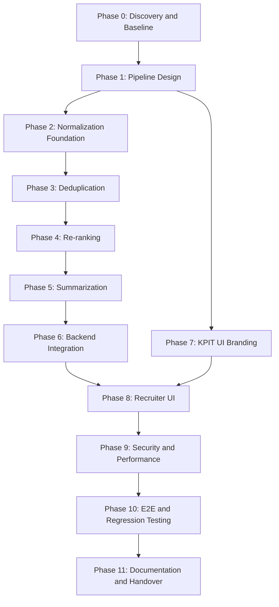

# Resume RAG Application — Phase-Wise Implementation Guide

**Project:** Existing Resume RAG Application  
**Organization branding:** KPIT  
**Stack:** Node.js, TypeScript, Express, MongoDB/MongoDB Atlas, Mistral `mistral-embed`, Multer, `pdf-parse`, optional LLM parser, configurable Groq  
**Purpose:** Implement the enhancement incrementally in the existing codebase, validating each phase before moving to the next.

---

## How to Use This Guide

Use this guide with your coding agent from the **root directory of the existing Resume RAG project**.

- Execute **one phase at a time**.
- Give the agent the prompt for the current phase only.
- Require it to inspect the codebase and report its findings before editing.
- Require it to run the relevant tests before marking a phase complete.
- Do not proceed to the next phase until the current phase's exit criteria are met.
- Keep a running implementation log and record files changed, commands run, test results, issues and decisions.
- If a phase reveals a dependency or risk, stop and report it instead of silently changing scope.

## Global Rules — Apply to Every Phase

1. Enhance the existing application; do not rebuild it from scratch.
2. Inspect actual code, architecture, data structures and existing tests before editing.
3. Preserve existing working functionality, APIs and user workflows unless a change is necessary and justified.
4. Reuse the existing Mistral embedding, MongoDB and resume ingestion/retrieval architecture.
5. Do not invent files, APIs, database fields or architecture without verifying the codebase.
6. Do not use mock data to claim integration is complete.
7. Do not make destructive database changes or candidate merges.
8. Do not treat similar names or resume content alone as sufficient evidence to merge candidates.
9. Do not fabricate candidate facts, skills, experience or ranking evidence.
10. Make Groq and other optional AI integrations configurable. Gracefully handle missing configuration and provider failures.
11. Do not hardcode API keys or secrets. Use environment variables.
12. Avoid unnecessary paid services, dependencies, frameworks, migrations or refactoring.
13. Use proper TypeScript types and existing project conventions.
14. Implement validation, safe logging, error handling, timeouts and bounded retries as appropriate.
15. Do not expose secrets, stack traces or sensitive resume data in the UI or logs.
16. Run tests and build checks where available. Report only tests actually run.
17. At the end of each phase, report: changes, files, tests, results, issues, decisions and readiness for the next phase.
18. If unable to run a test due to environment, credentials, data or external services, state the limitation clearly.

---

# Phase 0 — Codebase Discovery, Baseline and Implementation Plan

## Goal
Understand the existing application and establish a baseline before changing code.

## Prompt to the coding agent

> Perform Phase 0 only: discovery, architecture analysis and baseline validation. Do not implement enhancement features yet.
>
> Inspect the repository and identify the actual frontend and backend architecture, entry points, routes, controllers, services, data access, MongoDB collections and schema patterns, resume upload and parsing flow, Mistral embedding service, retrieval/search flow, existing LLM integrations, configuration, UI, testing setup and startup commands.
>
> Trace the current resume ingestion flow and search flow end to end. Identify what is already working and what can be reused.
>
> Run existing tests, lint, type-check and build commands where available. Do not change code merely to make the baseline pass unless you identify and separately explain a necessary minimal fix; first record the baseline failures.
>
> Create or update a project implementation log (prefer a suitable existing documentation location; otherwise create `IMPLEMENTATION_LOG.md`) and record:
> - Architecture summary
> - Existing ingestion and retrieval flow
> - Relevant files and modules
> - Existing APIs
> - Database collections and relevant fields
> - Existing UI pages/components
> - Baseline test/build results
> - Risks, gaps and dependencies
> - Proposed phase sequence
>
> Do not assume a frontend framework or database schema. Confirm them from the code.

## Deliverables
- Verified architecture map
- Verified ingestion and search flow
- Baseline test/build report
- Risk and dependency list
- Implementation log

## Exit criteria
- The current architecture and relevant code paths are identified.
- Existing functionality and baseline test status are documented.
- No enhancement implementation has been performed yet.
- The implementation log is ready for subsequent phases.

---

# Phase 1 — Design the Enhanced Retrieval Pipeline

## Goal
Define the integration design based on Phase 0 findings without prematurely changing application behavior.

## Prompt to the coding agent

> Perform Phase 1 only: design the enhanced resume search pipeline using the actual architecture discovered in Phase 0.
>
> Propose the smallest maintainable set of changes to integrate:
> 1. Existing retrieval
> 2. Candidate normalization
> 3. Duplicate detection
> 4. Re-ranking
> 5. Candidate summarization
> 6. Final result preparation
> 7. Frontend display
>
> Determine the most practical ordering of deduplication and re-ranking for this codebase. Explain the tradeoffs.
>
> Identify service boundaries, data contracts, configuration, error handling, fallback behavior, API changes (if needed), database implications (if any), test strategy and integration risks.
>
> Prefer reuse of existing modules. Do not introduce new frameworks or database migrations unless justified. If the current architecture makes a requirement infeasible, explain the constraint and propose a safe alternative.
>
> Create/update the implementation log with the design, decisions, tasks and dependencies. Do not implement the pipeline yet.

## Deliverables
- Pipeline design and flow
- Data contract proposal grounded in existing types/schema
- Configuration plan
- API/UI integration plan
- Test plan and risk notes

## Exit criteria
- Pipeline design is documented and consistent with the existing architecture.
- All required changes and dependencies are identified.
- No unexplained schema or architecture assumptions remain.

---

# Phase 2 — Retrieval Result Normalization and Pipeline Foundation

## Goal
Create or improve the foundation for consistently processing retrieved resume results.

## Prompt to the coding agent

> Perform Phase 2 only: implement the retrieval-result normalization and pipeline foundation according to the approved Phase 1 design.
>
> Reuse the existing retrieval implementation. Do not replace the embedding model, MongoDB retrieval mechanism or existing search APIs unnecessarily.
>
> Implement only the foundational normalization/orchestration changes needed for subsequent deduplication, ranking and summarization. Normalize existing retrieved candidate data into a typed internal representation while preserving candidate/resume identifiers, source information, original retrieval scores and available evidence.
>
> Handle incomplete or malformed candidate records safely. Do not fabricate missing information. Avoid destructive database changes and unnecessary data migrations.
>
> Add unit tests for normalization and pipeline foundation. Run relevant checks and update the implementation log.
>
> Do not implement re-ranking, deduplication or summarization yet unless a small shared foundation is required and clearly identified.

## Deliverables
- Typed normalized retrieval result model or equivalent
- Foundation/orchestration changes
- Unit tests
- Updated implementation log

## Exit criteria
- Retrieved results can be normalized consistently.
- Original identifiers, score and source references are preserved.
- Missing data is handled safely.
- Tests and build/type checks for this phase pass, or limitations are documented.

---

# Phase 3 — Resume Deduplication

## Goal
Reduce repeated candidate results while minimizing false merges.

## Prompt to the coding agent

> Perform Phase 3 only: implement deduplication of retrieved resume results.
>
> Inspect the available fields and data before choosing deduplication signals. Use signals where available, such as:
> - Existing candidate identifiers
> - Normalized email
> - Exact resume/file hash
> - Normalized name as a supporting signal, not a standalone merge criterion
> - Resume content similarity as a supporting signal, not proof of identity
> - Existing resume-version relationships
>
> Implement deduplication within the search-result pipeline. Prefer non-destructive result consolidation rather than database merging. Where multiple resume versions appear to belong to the same candidate, select or represent the most relevant version while preserving references to the other records if the architecture permits.
>
> Similar names, shared skills or similar resume content alone must not cause two candidates to be merged. If identity confidence is insufficient, keep the records separate.
>
> Make thresholds or configuration adjustable where appropriate. Explain the chosen rules and tradeoffs.
>
> Add tests for exact duplicates, different filenames with identical content, same email with multiple versions, missing email, missing name, similar names for different people, similar content for different candidates, and incomplete records. Do not create destructive data migrations.
>
> Run relevant tests, review the code and update the implementation log.

## Deliverables
- Deduplication service or equivalent
- Documented deduplication rules
- Configurable thresholds, if applicable
- Unit/integration tests
- Updated implementation log

## Exit criteria
- Duplicate search results are safely consolidated where confidence is adequate.
- False-positive merge scenarios are tested.
- Original data and identifiers are preserved.
- Deduplication tests pass or blockers are documented.

---

# Phase 4 — Re-Ranking

## Goal
Improve the relevance order of retrieved and deduplicated candidates against the recruiter query/job description.

## Prompt to the coding agent

> Perform Phase 4 only: implement candidate re-ranking.
>
> Reuse the current retrieval and normalized candidate pipeline. Use the deduplicated result set where the Phase 1 design specifies it.
>
> Implement a configurable re-ranking approach. Prefer the existing supported LLM integration or a configurable Groq integration if appropriate, but do not make Groq mandatory. The application must have a reasonable fallback using existing retrieval scores or a deterministic method when the provider is unavailable or not configured.
>
> Evaluate candidate relevance using evidence from the resume and the query/job description, such as required skills, relevant experience, responsibilities, domain expertise, projects and explicitly relevant qualifications. Do not use protected or sensitive characteristics or infer them from resumes. Do not make hiring decisions; present ranking as recruiter-assistance information.
>
> Preserve the original retrieval score and clearly distinguish it from the re-ranking score. Provide an explainable result with evidence-supported rationale. Do not treat the score as a probability of employment success.
>
> Validate LLM responses. Handle timeouts, rate limits, malformed responses, provider errors and partial failures. Use bounded retries only where appropriate. Do not expose secrets or unnecessarily send sensitive information.
>
> Add tests for relevant and irrelevant candidates, missing data, invalid model output, provider unavailable, timeout, rate limits and fallback ranking. Run tests and update the implementation log.

## Deliverables
- Re-ranking service or equivalent
- Provider/model configuration
- Fallback strategy
- Ranking output and explanation
- Unit/integration tests

## Exit criteria
- Ranking works with the configured provider and/or fallback.
- Scores and evidence are returned in a consistent typed format.
- Provider failure does not unnecessarily break the search flow.
- Ranking tests pass or limitations are documented.

---

# Phase 5 — Candidate Summarization

## Goal
Generate concise, job-specific candidate summaries grounded in resume evidence.

## Prompt to the coding agent

> Perform Phase 5 only: implement candidate summarization for final ranked results.
>
> Summarize candidates based on their actual resume data and the recruiter query/job description. Reuse existing LLM services where appropriate and implement configurable Groq integration if needed. Do not make summarization dependent on Groq being available.
>
> Where supported by the data, summaries should include:
> - Candidate name or identifier
> - Relevant skills
> - Relevant experience
> - Relevant projects
> - Education
> - Certifications
> - Strengths against the job requirements
> - Gaps or missing requirements
> - Evidence or references
> - Ranking explanation
>
> Adapt to actual existing fields. Clearly indicate missing or unavailable information. Never invent qualifications, employment history, skills, projects, education, certifications or years of experience.
>
> Ensure the summary is concise and job-specific rather than repeating the full resume. Validate output structure and handle timeouts, rate limits, provider failures and malformed output. Provide a reasonable fallback where feasible.
>
> Add tests for complete and incomplete resumes, missing fields, irrelevant content, invalid model responses, provider failures and fallback. Run tests and update the implementation log.

## Deliverables
- Summary service or equivalent
- Structured summary type
- Configurable model integration
- Fallback behavior
- Unit/integration tests

## Exit criteria
- Summaries are grounded in available resume data.
- Missing information is not fabricated.
- Provider failure is handled.
- Summary tests pass or limitations are documented.

---

# Phase 6 — End-to-End Backend Pipeline Integration

## Goal
Integrate retrieval, normalization, deduplication, re-ranking and summarization into the existing backend search flow.

## Prompt to the coding agent

> Perform Phase 6 only: integrate the completed backend components into the existing search API and orchestration flow.
>
> Integrate the components in the order approved in Phase 1 and appropriate to the codebase:
> - Query validation and processing
> - Existing Mistral embedding generation
> - Existing MongoDB retrieval
> - Result normalization
> - Deduplication
> - Re-ranking
> - Final candidate selection
> - Summarization
> - Final response construction
>
> Preserve existing API behavior where possible. If API changes are needed, document the changes and update consumers and tests. Do not create a parallel search API without justification.
>
> Ensure configurable retrieval/final result limits, safe logging, validation, error handling, timeout controls and graceful fallback. Avoid uncontrolled concurrent LLM calls or unnecessary repeated calls.
>
> Test the pipeline with realistic test data where available. Do not use mock data to claim live integration is complete. Where external services are unavailable, use tests that explicitly identify the mocked component and separately report the integration limitation.
>
> Add integration/API tests and update the implementation log.

## Deliverables
- Integrated backend pipeline
- API response contract
- Error/fallback handling
- API/integration tests
- Updated implementation log

## Exit criteria
- Existing search flow invokes the enhanced pipeline.
- API contract is consistent and documented.
- Integration tests pass or limitations are documented.
- Existing search functionality is not broken.

---

# Phase 7 — KPIT Branding and UI Design Foundation

## Goal
Apply verified KPIT branding and establish reusable UI styling.

## Prompt to the coding agent

> Perform Phase 7 only: research and implement the KPIT branding foundation in the existing UI.
>
> Verify the KPIT logo and branding colours using official KPIT sources where reasonably possible. Prefer official logo assets. Do not invent official colour codes or use an unverified logo as if it were official. If official assets cannot be verified or downloaded, document the limitation and use a clearly identified placeholder or a professionally designed approximation.
>
> Inspect the existing frontend and implement branding through reusable theme/configuration components where appropriate. Include organization name, logo, colour palette, typography, spacing, consistent components and a professional enterprise visual style.
>
> Do not unnecessarily replace the frontend framework or existing UI architecture. Do not implement the full candidate-results UI in this phase; establish the branding foundation and shared components first.
>
> Ensure accessibility and responsive foundations. Run existing UI tests/build and update the implementation log.

## Deliverables
- Verified logo asset or documented fallback
- Theme/branding configuration
- Reusable UI styling foundation
- UI build/tests
- Updated implementation log

## Exit criteria
- Branding foundation is integrated into the existing frontend.
- Logo source and colour choices are documented.
- Existing UI remains functional.
- Build/tests pass or limitations are documented.

---

# Phase 8 — Recruiter Search and Results UI

## Goal
Display the enhanced pipeline results in a clear, recruiter-friendly dashboard.

## Prompt to the coding agent

> Perform Phase 8 only: implement the recruiter search and results UI using the existing frontend architecture and the backend contract from Phase 6.
>
> Create or enhance the recruiter dashboard with:
> - KPIT branding
> - Search query/job-description input
> - Search action
> - Search/loading status
> - Result summary
> - Ranked candidate results
> - Candidate cards or a table with expandable details, whichever best fits the existing UI
> - Final rank
> - Relevant score information, clearly distinguishing original retrieval and re-ranking scores
> - Key skills and relevant experience
> - Summary
> - Strengths and gaps, where supported
> - Ranking explanation
> - Candidate/resume details or access options where existing functionality supports them
>
> Implement appropriate filtering and sorting only where the actual backend data supports them.
>
> Integrate with the real backend API. Do not use static mock candidate data to replace the API.
>
> Implement loading, success, empty, validation, error and network-failure states. Do not expose internal server errors or sensitive details to users.
>
> Make the UI responsive and accessible. Run UI tests and build checks. Update the implementation log.

## Deliverables
- Recruiter dashboard/search UI
- Candidate results presentation
- Filtering/sorting, where supported
- Candidate detail interaction
- UI state handling
- UI tests/build report

## Exit criteria
- Search UI uses real backend results.
- Results and summaries display correctly.
- UI states are handled.
- Responsive behavior is validated.
- UI tests/build pass or limitations are documented.

---

# Phase 9 — Configuration, Security, Performance and Reliability Review

## Goal
Review and harden the integrated application.

## Prompt to the coding agent

> Perform Phase 9 only: review configuration, security, performance and reliability of the enhanced application.
>
> Review and improve as necessary:
> - Environment-variable validation
> - Secret handling
> - Resume upload/file validation
> - API input validation
> - Sensitive data handling
> - Logging
> - MongoDB query efficiency
> - Candidate result limits
> - LLM call volume
> - Concurrency control
> - Timeouts
> - Bounded retries
> - Fallback behavior
> - Memory usage
> - Error handling
> - UI/backend error boundaries
>
> Use the existing architecture and make only justified changes. Do not introduce unnecessary services, paid dependencies or migrations.
>
> Document configuration requirements and any new environment variables. Ensure secrets are not committed or exposed. Review whether resume data is unnecessarily transmitted to LLM providers and minimize it where possible.
>
> Run security-relevant tests, performance checks where feasible and regression checks. Update the implementation log.

## Deliverables
- Configuration/security/reliability improvements
- Updated environment/config documentation
- Security and performance review notes
- Tests and validation report

## Exit criteria
- Configuration is documented and validated where appropriate.
- Secrets and sensitive information are handled safely.
- Reliability and performance issues identified are addressed or documented.
- Checks pass or limitations are documented.

---

# Phase 10 — Complete End-to-End, Regression and Acceptance Testing

## Goal
Validate the full application workflow and existing functionality.

## Prompt to the coding agent

> Perform Phase 10 only: complete end-to-end, regression and acceptance testing of the enhanced application.
>
> Test the complete workflow using realistic data and the actual application wherever the environment permits:
> 1. Start backend and frontend.
> 2. Validate application availability.
> 3. Upload/ingest a resume using the existing workflow, if required for the test.
> 4. Validate PDF extraction and parsing.
> 5. Validate embedding and MongoDB storage.
> 6. Submit a recruiter query or job description.
> 7. Validate retrieval.
> 8. Validate normalization.
> 9. Validate deduplication.
> 10. Validate re-ranking.
> 11. Validate summarization.
> 12. Validate final API response.
> 13. Validate candidate results and details in the UI.
> 14. Validate loading, empty, success, validation and error states.
> 15. Validate fallback behavior when optional AI services are unavailable.
>
> Perform unit, API, integration, UI, RAG retrieval, re-ranking, deduplication, summarization and regression tests as supported.
>
> Revalidate existing resume upload, parsing, embedding, storage and search functionality. Do not claim a test passed unless it was executed and its result was observed. Clearly separate tests using mocked external services from live tests.
>
> Record the test scenarios, expected and actual results, status, evidence or logs where available, and limitations in the implementation log. Fix issues discovered within scope and retest affected functionality.

## Deliverables
- Test execution report
- Regression report
- End-to-end validation
- Defect list and fixes
- Updated implementation log

## Exit criteria
- Complete workflow has been tested to the extent the environment permits.
- Existing functionality is regression-tested.
- Failed and pending tests are explicitly documented.
- No fabricated test results.

---

# Phase 11 — Documentation, Final Review and Handover

## Goal
Provide a maintainable implementation and clear handover.

## Prompt to the coding agent

> Perform Phase 11 only: final code review, documentation and handover.
>
> Review the final changes for unnecessary duplication, type safety, error handling, secrets, maintainability, API consistency and regression risk.
>
> Update project documentation with:
> - Enhanced architecture and pipeline flow
> - Re-ranking approach
> - Deduplication logic and safeguards
> - Summarization approach
> - KPIT branding assets and theme choices
> - API changes
> - Configuration and environment variables
> - Installation/setup instructions
> - Startup instructions
> - Test commands
> - Test results and limitations
> - Known issues
>
> Provide a final report with:
> - Summary of implemented features
> - Files created/modified
> - Architecture changes
> - Database changes, if any
> - Configuration changes
> - Tests executed and actual results
> - Failed/pending tests
> - Known limitations
> - Startup and validation instructions
>
> Do not claim completion for unimplemented or untested items. Update the implementation log and mark the project handover complete only when the evidence supports it.

## Deliverables
- Updated documentation
- Final implementation report
- Final test report
- Updated implementation log

## Exit criteria
- Implementation and configuration are documented.
- Final code review is completed.
- Test status and limitations are transparent.
- Handover is complete.

---

# Dependency Overview

## Suggested implementation log structure

Keep `IMPLEMENTATION_LOG.md` (or an existing equivalent) updated throughout:

- Date and phase
- Objective
- Inspection findings
- Decisions made
- Files created/modified
- Configuration changes
- Commands executed
- Tests executed
- Results
- Issues and resolutions
- Pending items
- Phase exit status

## Final acceptance checklist

- [ ] Existing application architecture inspected
- [ ] Baseline tests recorded
- [ ] Pipeline design documented
- [ ] Result normalization implemented
- [ ] Deduplication implemented and tested
- [ ] Re-ranking implemented and tested
- [ ] Summarization implemented and tested
- [ ] Backend pipeline integrated
- [ ] KPIT logo/branding verified or limitation documented
- [ ] Theme implemented
- [ ] Recruiter UI integrated with real backend
- [ ] Loading, success, empty, validation and error states implemented
- [ ] Configuration and secrets handled safely
- [ ] Performance/reliability review completed
- [ ] End-to-end tests executed
- [ ] Regression tests executed
- [ ] Documentation updated
- [ ] Final implementation report prepared
- [ ] Failed and pending tests documented honestly

**Implementation principle:** Complete one phase, verify it, document it and then proceed. Avoid implementing all phases in one uncontrolled change.
